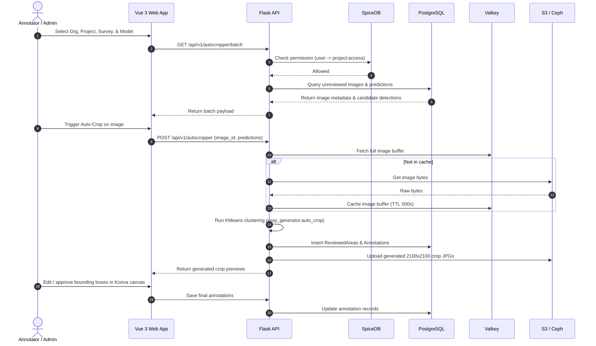

# System Architecture

Airial is an aerial wildlife census and abundance estimation platform designed for high data volumes, model-assisted labeling, and multi-user verification.

---

## 1. High-Level Topology

```
                          +-------------------------------+
                          |    Vue 3 Single Page App      |
                          |      (generator_web_app)      |
                          |  TypeScript, Pinia, Konva     |
                          +---------------+---------------+
                                          |
                                          | HTTP / REST (Port 8000)
                                          v
                          +-------------------------------+
                          |        Flask REST API         |
                          |         (airial_api)          |
                          |   Python 3.13+, Werkzeug      |
                          +---+-------+-------+-------+---+
                              |       |       |       |
         +--------------------+       |       |       +--------------------+
         |                            |       |                            |
         v                            v       v                            v
+------------------+         +--------------+  +---------------+         +------------------+
|  PostgreSQL 18   |         |  Valkey 8.1  |  |    SpiceDB    |         |    S3 / Ceph     |
| (Custom Psycopg3)|         | (Cache/Sess) |  |    (ReBAC)    |         | (Object Storage) |
+------------------+         +--------------+  +---------------+         +------------------+
```

---

## 2. Core Components

### 1. Frontend Web App (`generator_web_app/`)
* **Framework**: Vue 3 using `<script setup lang="ts">` and Vite 6.
* **State Management**: [Pinia](https://pinia.vuejs.org/) stores (`projectStore.ts`, `cropperStore.ts`, `cropVerifierStore.ts`, `systemStore.ts`) with `pinia-plugin-persistedstate`.
* **Annotation Canvas**: Built with [Vue-Konva](https://konvajs.org/docs/vue/) for interactive zooming, panning, and rendering/editing bounding boxes on high-resolution image crops.
* **Routing**: Dynamic routing with navigation guards checking API bootstrap readiness and authentication state.

### 2. Backend REST API (`airial_api/`)
* **Framework**: Flask 3.1 running under Werkzeug (dev) or Gunicorn (production).
* **Dependency Management**: Astral `uv` (`pyproject.toml`, `uv.lock`).
* **Modularity**: Subdivided into blueprint routers (`app/routers/`):
  * `autocropper.py`: Batch retrieval, K-Means crop triggering, reviewed area and annotation generation.
  * `cropverifier.py`: Single prediction chip serving and review status tracking.
  * `images.py`: Image metadata, S3 presigned GET/PUT URLs, multipart upload coordination.
  * `projects.py`, `surveys.py`, `herd_units.py`, `models.py`, `schemas.py`, `labels.py`: Hierarchy management.
  * `authenticate.py`, `users.py`, `roles.py`, `organizations.py`: User identity and session management.

### 3. Database Layer (PostgreSQL 18)
* **Custom Abstraction (`airial_api/database/database.py`)**:
  * **Strictly NO ORM**: Uses `psycopg3` directly with connection pooling (`psycopg-pool`).
  * Explicit SQL construction via `psycopg.sql` to avoid ORM overhead, N+1 query traps, and slow spatial query execution.
  * Context wrapper (`@connect`) automatically manages checkout/checkin of connections.
  * Dual-identifier model: Tables support both integer primary keys and UUIDs.
  * Automatic deserialization into Pydantic models.

### 4. Authorization & Permissions (SpiceDB)
* **ReBAC Engine**: Built on Google Zanzibar concepts using [SpiceDB](https://authzed.com/spicedb).
* **Schema Definition**: Located in `airial_api/database/spicedb_schema/schema.zed`.
* **Route Protection**: Declarative route decorators (`@permission_required("access")`, `@roles_required("admin")`) enforce permissions via gRPC calls to SpiceDB before executing business logic.

### 5. Cache & Session Store (Valkey 8.1)
* Open-source, drop-in Redis fork.
* **Database 0**: Flask-Session for cryptographically signed user sessions.
* **Database 1**: Flask-Caching for caching image buffers, temporary prediction chips, and frequently queried metadata.

### 6. Object Storage (S3 / Ceph)
* Boto3 client pointing to an S3-compliant store (e.g., University of Wyoming ARCC Ceph Gateway or AWS S3).
* High-resolution raw survey images and generated reviewed-area crops are stored in S3.
* Direct upload/download capabilities via presigned URLs and chunked multipart uploads.

---

## 3. Data Flow


